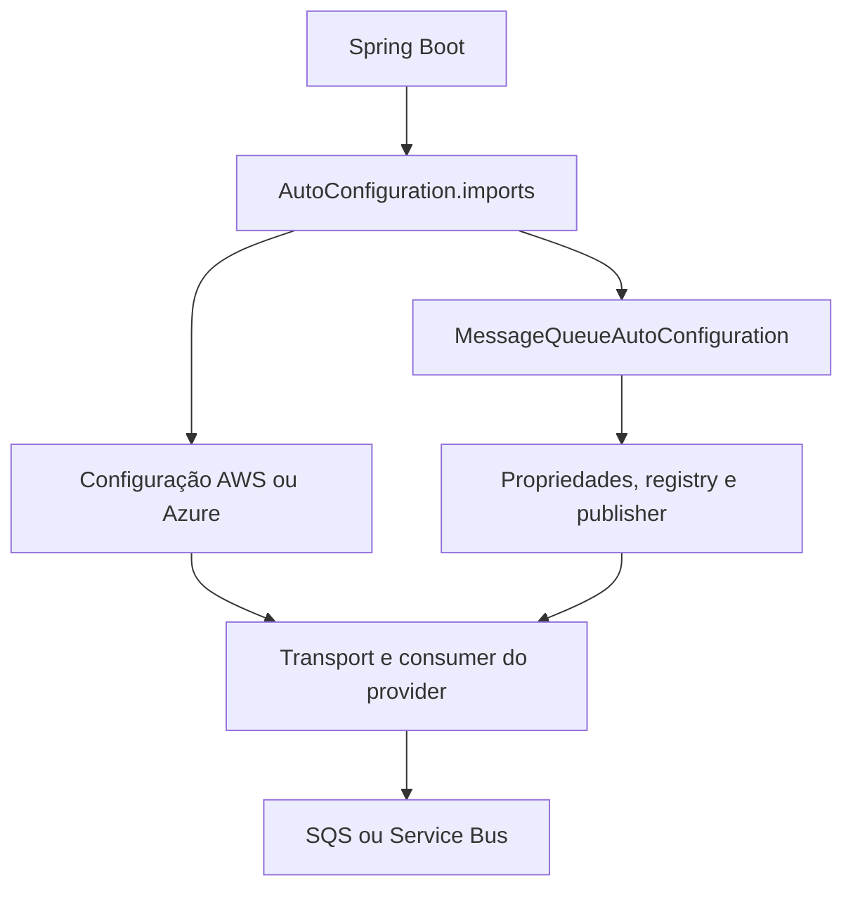
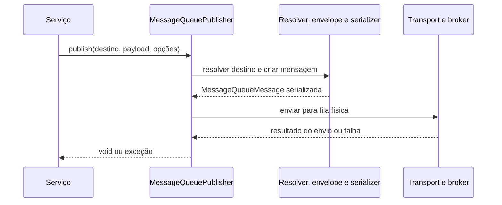
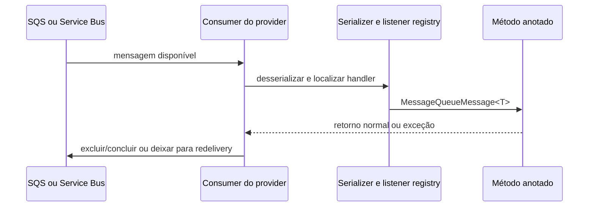

# Platform Message Queue: arquitetura interna

## Para que serve este guia

Este guia acompanha a implementação de `platform-message-queue`. Ele começa pela inicialização e configuração, depois segue os fluxos de publicação, consumo e dead-letter. A ideia é explicar por que cada parte existe e como as chamadas atravessam a biblioteca, para que alguém novo no módulo consiga navegar e mantê-lo.

O [guia da Golden Platform](https://github.com/BrunoBS/golden-platform/blob/main/docs/libraries/modules/platform-message-queue.md) explica como um serviço consumidor configura e usa a biblioteca. Este documento complementa esse guia com a arquitetura interna.

## Visão da arquitetura

A biblioteca expõe uma API independente de broker. O serviço escolhe um destino lógico e publica um objeto ou declara um listener. A configuração seleciona AWS SQS ou Azure Service Bus; o adapter converte a API comum para a SDK do provider.



A API se divide por finalidade: `api.annotation` declara listeners e metadados do payload; `api.contract` contém interfaces e tipos neutros; `api.configuration` define as propriedades e o seletor de provider. Configurações Spring ficam fora de `api`, enquanto detalhes de SDK e processamento ficam em `provider` e `internal`.

## Organização dos pacotes

| Pacote | O que contém | Avaliação |
|---|---|---|
| `api.annotation` | `@MessageQueueListener`, `@MessageQueueDeadLetterListener` e `@QueueMessage`. | Adequado: são declarações que o serviço consumidor usa no código. |
| `api.configuration` | `MessageQueueProperties` e `MessageQueueProvider`. | Adequado: propriedades e enum fazem parte do contrato de configuração público que o Spring faz bind. |
| `api.contract` | `MessageQueuePublisher`, envelopes/opções, dead-letter, contexto de entrega e catálogos de integração. | Adequado: agrupa tipos públicos neutros em relação ao broker. Os catálogos são interfaces de leitura para integrações da plataforma; o contexto de entrega permite consultar dados confiáveis durante a execução do listener. |
| `configuration` | Auto configuração comum do Spring Boot. | Adequado: cria beans compartilhados, sem depender da SDK de um provider. |
| `provider.aws` e `provider.azure` | Auto configuração, clients, transportes, consumers e descoberta de capacidades de cada broker. | Adequado: concentra diferenças de protocolo e SDK sem expô-las ao serviço consumidor. |
| `internal` | Resolução de destinos, envelope, serialização, registry de listeners/capacidades, MDC e transporte interno. | Adequado: são mecanismos de implementação e não pontos de extensão para aplicações. |

A separação existente já dá um caminho de leitura claro. Não abri subpacotes adicionais dentro de `api.contract`: são poucos tipos e ficam juntos por compor a superfície neutra da biblioteca. Dividi-los em pastas de request/response/model aqui criaria mais navegação sem uma diferença de ciclo de vida ou responsabilidade que justificasse a divisão.

Um ponto para acompanhar é o tamanho da API pública: os catálogos e o contexto de entrega atendem integrações da plataforma além do uso básico de publicação e listeners. Mantê-los em `api.contract` deixa explícito que são contratos públicos; qualquer mudança futura deve considerar compatibilidade com essas integrações.

## Dependências do módulo

| Dependência no POM | Uso |
|---|---|
| `spring-boot-autoconfigure` | Auto configurações, condições e registro de beans. |
| `spring-boot-starter-json` | JSON da mensagem; o serializer recebe o `ObjectMapper` do contexto. |
| `slf4j-api` | Logs do polling, processamento e falhas de transporte. |
| `platform-messaging-core` | Exceções e definições padronizadas de erro e validação. |
| AWS SDK `sqs` | Publicação, polling, exclusão, atributos e consulta de filas SQS. |
| `azure-messaging-servicebus` | Envio, recebimento, sessões, conclusão/abandono e administração do Service Bus. |
| `azure-identity` | Credencial Azure padrão via `DefaultAzureCredentialBuilder`. |
| `spring-boot-configuration-processor` | Opcional; metadados das propriedades para IDEs. |
| `spring-boot-test`, `platform-testing-core`, fixtures AWS e Azure | Suporte de testes, somente no escopo de teste. |

As duas SDKs estão no mesmo artefato porque o módulo oferece uma única API para os dois brokers. Os adapters ficam separados onde as semânticas realmente divergem, como confirmação de mensagem, sessões e opções de ordenação.

## Propriedades de configuração

Todas as propriedades usam o prefixo `platform.message-queue`. `MessageQueueProperties` rejeita campos desconhecidos e valida a configuração na inicialização. Assim, erro de digitação em nome de propriedade não passa despercebido.

Exemplo AWS:

```yaml
platform:
  message-queue:
    provider: AWS
    shutdown-timeout: 30s
    poll-failure-backoff: 1s
    aws:
      region: us-east-1
      defaults:
        wait-time: 20s
        concurrency: 2
    destinations:
      orders:
        queue: golden-orders
        publisher:
          enabled: true
        consumer:
          enabled: true
          concurrency: 4
        aws:
          dead-letter-queue: golden-orders-dlq
          visibility-timeout: 90s
```

Exemplo Azure:

```yaml
platform:
  message-queue:
    provider: AZURE
    shutdown-timeout: 30s
    poll-failure-backoff: 1s
    azure:
      namespace: golden.servicebus.windows.net
      max-auto-lock-renewal-duration: 5m
      defaults:
        wait-time: 20s
        concurrency: 2
    destinations:
      orders:
        queue: golden-orders
        publisher:
          enabled: true
        consumer:
          enabled: true
          concurrency: 4
```

| Propriedade | Obrigatória / padrão | AWS | Azure | Finalidade |
|---|---|---|---|---|
| `provider` | Obrigatória: `AWS` ou `AZURE`. | Ativa SQS. | Ativa Service Bus. | Seleciona a auto configuração e o adapter. |
| `shutdown-timeout` | Opcional; padrão `30s`. | Usada. | Usada. | Tempo máximo de encerramento gracioso dos workers antes de cancelar e fechar recursos. |
| `poll-failure-backoff` | Opcional; padrão `1s`. | Usada após falhas de polling. | Usada após falhas de polling ou de aquisição de sessão. | Evita um loop apertado de tentativas quando o broker falha. |
| `aws.region` | Obrigatória com AWS. | Usada para construir `SqsClient`. | Não usada. | Define a região AWS. A cadeia padrão de credenciais da SDK resolve as credenciais. |
| `azure.namespace` | Obrigatória com Azure. | Não usada. | Usada para construir os clients de Service Bus. | Identifica o namespace Azure; a credencial vem de `DefaultAzureCredential`. |
| `azure.max-auto-lock-renewal-duration` | Opcional; padrão `5m`; máximo validado de 12 horas. | Não usada. | Usada nos receivers. | Limita por quanto tempo o client renova automaticamente o lock enquanto o listener processa a mensagem. |
| `aws.defaults` / `azure.defaults` | Opcionais. | Defaults de `wait-time`, `concurrency` e `visibility-timeout`. | Defaults de `wait-time` e `concurrency`. | Fornecem valores comuns para destinos sem configuração própria. O bloco do provider inativo não é usado. |
| `destinations` | Obrigatória; precisa conter pelo menos um destino. | Usada. | Usada. | Mapeia um nome lógico usado pela aplicação para o nome físico da fila. |
| `destinations.<nome>.queue` | Obrigatória para cada destino. | Nome da fila SQS. | Nome da fila Service Bus. | Identificador físico usado pelo broker. |
| `destinations.<nome>.publisher.enabled` | Opcional; padrão `true`. | Usada. | Usada. | Permite bloquear publicação para um destino sem remover seu mapeamento. |
| `destinations.<nome>.consumer.enabled` | Opcional; padrão `true`. | Usada. | Usada. | Liga ou desliga os workers registrados para aquele destino. |
| `destinations.<nome>.consumer.wait-time` | Opcional. | Long polling SQS; de 0 a 20 segundos. | Espera de recebimento; inteiro de segundos maior que zero. | Ajusta a espera do receive para aquele destino. Se omitido, o provider usa seu default efetivo de 20 segundos. |
| `destinations.<nome>.consumer.concurrency` | Opcional; se omitido, efetivo `1`. | Usada. | Usada. | Quantidade de workers de consumo para o destino. Deve ser positiva quando definida. |
| `destinations.<nome>.aws.wait-time` e `concurrency` | Opcionais; somente AWS. | Sobrescrevem as opções equivalentes em `consumer`. | Não usadas. | Ajustes do destino específicos de SQS. |
| `destinations.<nome>.aws.visibility-timeout` | Opcional; de 0 a 12 horas. | Usada se configurada; sem valor, o request não sobrescreve a configuração da fila. | Não usada. | Define por quanto tempo a mensagem fica invisível enquanto está sendo processada. |
| `destinations.<nome>.aws.dead-letter-queue` | Opcional; somente AWS. | Fila SQS física explícita para o listener de dead-letter. | Não usada. | Se omitida, a biblioteca deriva o nome adicionando `-dlq` ou `-dlq.fifo` ao nome da origem. |
| `destinations.<nome>.azure.wait-time` e `concurrency` | Opcionais; somente Azure. | Não usadas. | Sobrescrevem as opções equivalentes em `consumer`. | Ajustes do destino específicos do Service Bus. |

A precedência de consumo é: ajuste do provider no destino, opção comum do destino e default do provider. Se concorrência não estiver definida em nenhum nível, o consumer usa um worker. Para o tempo de espera, os adapters usam 20 segundos quando não recebem valor.

Azure não usa `aws.*`; AWS não usa `azure.*`. Os blocos existem juntos no objeto de propriedades para permitir um prefixo de configuração comum, mas somente o provider selecionado lê e valida o seu bloco. `aws.defaults.visibility-timeout` é o default AWS adicional; não há equivalente de configuração global para o lock Azure, que é controlado por `azure.max-auto-lock-renewal-duration`.

## Inicialização no Spring

1. `META-INF/spring/org.springframework.boot.autoconfigure.AutoConfiguration.imports` registra a configuração comum, a AWS e a Azure.
2. `MessageQueueAutoConfiguration` habilita `MessageQueueProperties` e cria o relógio UTC, serializer, resolução de destino, envelope, registry de listeners e registry de capacidades. O publisher padrão só é criado se a aplicação não fornecer outro.
3. `MessageQueueProperties.afterPropertiesSet()` valida provider, destinos, tempos e o bloco do provider escolhido.
4. `@ConditionalOnProperty` ativa somente a configuração SQS ou Service Bus. `@ConditionalOnMissingBean` permite substituir client, transport ou publisher por beans fornecidos pela aplicação.
5. `MessageQueueListenerRegistry`, um `BeanPostProcessor`, encontra métodos anotados nos beans Spring e valida assinatura, tipo concreto do payload e destino.
6. Os consumers implementam `SmartLifecycle`; ao iniciar a aplicação, criam workers para os listeners registrados e habilitados. No encerramento, aguardam até `shutdown-timeout`, depois cancelam workers e fecham receivers.

| Anotação / mecanismo | Papel neste módulo |
|---|---|
| `@AutoConfiguration` | Marca as classes que o Spring Boot importa pelo arquivo de registro. |
| `@EnableConfigurationProperties` | Registra `MessageQueueProperties` para binding e validação. |
| `@ConfigurationProperties` | Faz o binding de `platform.message-queue`; `ignoreUnknownFields=false` rejeita chaves estranhas. |
| `@ConditionalOnProperty` | Escolhe AWS ou Azure conforme `provider`. |
| `@ConditionalOnMissingBean` | Mantém defaults substituíveis por integrações customizadas. |
| `@Bean` | Registra recursos e componentes no contexto. O `SqsClient` e o transport Azure declaram fechamento; os consumers gerenciam workers e receivers no ciclo de vida do Spring. |
| `BeanPostProcessor` | Descobre listeners nas classes gerenciadas pelo Spring. |
| `SmartLifecycle` | Inicia e encerra o polling no ciclo de vida da aplicação. |

## Contratos usados nos fluxos

O módulo não cria um par de request/response para cada operação. Publicação recebe parâmetros e opções; consumo entrega uma mensagem a um método anotado. O resultado do processamento é comunicado ao broker pelo acknowledge, não por um objeto de resposta da aplicação.

| Fluxo | Entrada pública | Saída do contrato | O que confirma o resultado |
|---|---|---|---|
| Publicar | `MessageQueuePublisher.publish(destination, payload, options)`; há overloads sem opções ou com correlation ID e headers. | `void` | O método termina normalmente após o envio; falhas são lançadas como exceções padronizadas. A API não devolve message ID nem recibo do broker. |
| Consumir mensagem | `@MessageQueueListener` e método com um único parâmetro `MessageQueueMessage<T>`; retorno `void`. | Sem valor de retorno. | SQS exclui a mensagem após sucesso. Service Bus a conclui com `complete`. |
| Consumir dead-letter | `@MessageQueueDeadLetterListener` e método com um único parâmetro `DeadLetterMessage<T>`; retorno `void`. | Sem valor de retorno. | Após sucesso, SQS exclui a cópia da DLQ e Service Bus conclui a mensagem na dead-letter subqueue. |
| Consultar destinos de integração | `MessageQueueDestinationCatalog.resolveForIntegration(destination)`. | `ResolvedDestination` (nome lógico, identificador físico e estado do consumer). | Consulta de metadados; não publica nem recebe mensagem. |
| Consultar listeners registrados | `MessageQueueListenerCatalog.registrations()`. | Coleção de `Registration` (destino e entry point). | Consulta do registry descoberto pelo Spring. |

`MessageQueueMessage<T>` é o envelope comum: message ID, tipo e versão, timestamp, correlation ID, headers e payload. Ele é produzido antes do envio e entregue ao listener depois da desserialização. Não é uma resposta da publicação.

## Publicação de mensagens

A interface de entrada é `MessageQueuePublisher`. O consumidor fornece o nome lógico do destino e o payload. Para dados opcionais, `MessageQueuePublishOptions` agrupa correlation ID, headers, ordering key e deduplication ID. Se as opções forem omitidas ou nulas, são usados valores padrão vazios.

A saída declarada é `void`: a chamada só retorna normalmente quando o envio ao broker termina. A biblioteca não expõe o ID do broker nem um recibo; erros de validação, destino desabilitado, serialização ou provider sobem como exceções da plataforma.

| Parte da publicação | Contrato / classe | O que carrega ou faz |
|---|---|---|
| Chamada | `MessageQueuePublisher` | `destination` lógico, payload e, opcionalmente, opções. |
| Opções | `MessageQueuePublishOptions` | `correlationId`, headers, `orderingKey` e `deduplicationId`. |
| Envelope gerado | `MessageQueueMessage<T>` | `messageId`, `messageType`, `messageVersion`, timestamp, correlation ID, headers e payload serializável. |
| Resposta pública | `void` | Nenhum objeto de resposta. Sucesso é retorno normal; falha é exceção. |

O caminho interno começa em `DefaultMessageQueuePublisher`: ele valida payload e destino, pede ao `DestinationResolver` que converta o nome lógico para a fila configurada, cria o envelope com `MessageEnvelopeFactory` e `MessageMetadataResolver`, serializa com `MessageQueueSerializer` e envia pelo `MessageQueueTransport` correspondente ao provider.



`@QueueMessage(type, version)` no tipo do payload declara metadados estáveis da mensagem. Sem a anotação, o type usa o nome lógico do destino e a version é `1`. Na recepção, a biblioteca compara esses valores para os payloads anotados.

### Ordenação e deduplicação

`orderingKey` e `deduplicationId` são opções da publicação, não campos do envelope `MessageQueueMessage`. Antes de enviar uma opção de ordenação, o `QueueCapabilitiesRegistry` consulta se a fila oferece esse recurso e guarda o resultado.

- Em SQS FIFO, `orderingKey` vira `MessageGroupId`. `deduplicationId` vira `MessageDeduplicationId` quando necessário; se a fila usa content-based deduplication, o ID pode ser dispensado.
- Em Service Bus com sessões, `orderingKey` vira `SessionId`. `deduplicationId` é uma opção específica de SQS FIFO e é rejeitada no Azure.
- Fila sem ordenação não aceita `orderingKey`. Combinações incompatíveis falham com validação antes de o serviço considerar o envio concluído.

`AwsQueueCapabilitiesResolver` busca os atributos SQS; `AzureQueueCapabilitiesResolver` consulta a administração do Service Bus. O registry compartilhado evita que os contratos públicos dependam dos nomes ou modelos de cada SDK.

## Consumo de mensagens

O consumidor declara `@MessageQueueListener("orders")` em um método Spring. O destino dentro da anotação é o nome lógico da configuração, não o nome físico da fila. A assinatura precisa ter exatamente um parâmetro `MessageQueueMessage<T>`, com tipo concreto `T`, e retornar `void`. `MessageQueueListenerRegistry` descobre e valida esses métodos durante a inicialização.

| Parte do consumo | Contrato / classe | O que representa |
|---|---|---|
| Declaração | `@MessageQueueListener` | Destino lógico que esse método atende. |
| Entrada do handler | `MessageQueueMessage<T>` | Envelope neutro desserializado, incluindo payload e metadados. |
| Resposta do handler | `void` | O handler sinaliza sucesso ao retornar normalmente; uma exceção sinaliza falha. |
| Resultado no broker | Provider-specific | SQS exclui após sucesso; Service Bus chama `complete`. Falhas preservam a possibilidade de redelivery. |



No SQS, cada worker faz long polling de uma mensagem por chamada. Depois do retorno normal do método, o consumer exclui a mensagem. Se desserialização ou handler falha, não exclui; a mensagem pode ser entregue de novo quando a visibilidade expirar.

No Service Bus, o receiver desativa auto-complete. O consumer chama `complete` após sucesso e `abandon` após falha. Fila com sessões usa receiver de sessão e mantém a ordenação por session ID. O lock pode ser renovado até `azure.max-auto-lock-renewal-duration`.

Durante a chamada normal, os adapters abrem `MessageQueueDeliveryContext` com provider, entry point, destino e IDs da entrega. `MessageQueueMdcContext` instala message ID e correlation ID no MDC, depois restaura o contexto anterior para que um worker não contamine a próxima mensagem.

## Dead-letter

`@MessageQueueDeadLetterListener("orders")` declara um handler separado para mensagens que chegaram à dead-letter queue/subqueue. Ele também retorna `void`, mas recebe `DeadLetterMessage<T>` em vez de `MessageQueueMessage<T>`.

| Parte do fluxo | Contrato / classe | O que representa |
|---|---|---|
| Declaração | `@MessageQueueDeadLetterListener` | Destino lógico associado ao handler de dead-letter. |
| Entrada | `DeadLetterMessage<T>` | Mensagem original mais reason, description, delivery count, data e metadados do provider quando disponíveis. Campos sem suporte do provider podem ser nulos. |
| Resposta do handler | `void` | Retorno normal indica processamento concluído; exceção mantém a mensagem disponível para redelivery. |
| Resultado no broker | Provider-specific | SQS exclui da DLQ após sucesso; Service Bus conclui a mensagem da dead-letter subqueue. |

Em SQS, `aws.dead-letter-queue` seleciona a fila física. Se omitida, a biblioteca deriva o nome da fila de dead-letter; um handler registrado exige que essa referência resolva. Em Service Bus, a biblioteca lê a dead-letter subqueue da fila. No caminho de dead-letter o MDC é configurado, mas `MessageQueueDeliveryContext` não é aberto; metadados de dead-letter são recebidos pelo próprio `DeadLetterMessage`.

## Contratos de consulta para integrações da plataforma

Além da publicação e consumo de mensagens, `api.contract` expõe interfaces de leitura para integrações confiáveis:

- `MessageQueueDestinationCatalog` recebe o nome lógico e retorna o destino resolvido com identificador físico e informação se o consumer está habilitado.
- `MessageQueueListenerCatalog` retorna a coleção de registros, cada um com o destino e o entry point do listener.
- `MessageQueueDeliveryContext.current()` retorna `Optional<Delivery>` para a entrega normal em execução na thread atual; o escopo é removido/restaurado ao terminar a chamada.

Esses contratos não são requests/responses do broker. Eles permitem consultar a configuração/registro e o contexto da entrega sem expor os clients AWS/Azure.

## Classes nos fluxos

Em vez de decorar uma lista de nomes, siga o caminho da chamada:

- **Na configuração:** `MessageQueueProperties` representa o que o consumidor declarou; `MessageQueueAutoConfiguration` monta os componentes comuns; as auto configurações AWS/Azure montam as dependências e adapters do provider escolhido.
- **Para escolher a fila:** `DestinationResolver` aplica os valores da configuração e produz `ResolvedDestination`, um tipo interno já pronto para os adapters.
- **Para publicar:** `DefaultMessageQueuePublisher` coordena validação, envelope, serialização e envio. `MessageEnvelopeFactory`, `MessageMetadataResolver` e `MessageQueueSerializer` cuidam de partes pequenas e reutilizáveis desse fluxo.
- **Para consumir:** `MessageQueueListenerRegistry` descobre e valida handlers; `SqsMessageQueueConsumer` e `AzureServiceBusMessageQueueConsumer` controlam workers e acknowledge/redelivery com as regras de cada broker.
- **Para capacidades do broker:** `QueueCapabilitiesRegistry` guarda o resultado e delega a consulta a `AwsQueueCapabilitiesResolver` ou `AzureQueueCapabilitiesResolver`.
- **Para erro e observabilidade:** `MessageQueueMessageKeys` fornece as chaves de erro, `MessageQueueTechnicalErrors` cria a definição técnica de configuração, e `MessageQueueMdcContext` isola o MDC por entrega.

## Revisão de simplicidade

### Organização mantida

Os pacotes atuais já separam superfície pública, boot do Spring, comportamento compartilhado e SDKs concretas. Não recomendo mover classes agora: isso não corrigiria uma responsabilidade cruzada observada e faria a navegação depender de mais pastas.

Os dois consumers e transports são necessários porque SQS e Service Bus diferem no ack, DLQ, visibilidade/lock e ordenação. A lógica comum fica em envelope, serializer, resolução e contratos, sem uma abstração que esconda as operações importantes do broker.

### Acompanhar

- A API pública inclui os catálogos de destino/listeners e `MessageQueueDeliveryContext`, além do publisher e dos tipos de mensagem. Isso é útil para integrações da plataforma, mas cada tipo público passa a ser um compromisso de compatibilidade; confirme sua necessidade quando revisar consumidores do módulo.
- `MessageQueueProperties` concentra propriedades comuns e específicas dos dois providers em uma árvore de configuração. Essa forma dá um único prefixo consistente; se novos providers forem adicionados, reavaliar o tamanho e a validação central dessa classe.
- As opções `orderingKey` e `deduplicationId` são uma API neutra com suporte desigual entre providers. O comportamento hoje está explícito e validado; documentar essa diferença é mais simples que fingir equivalência entre brokers.

