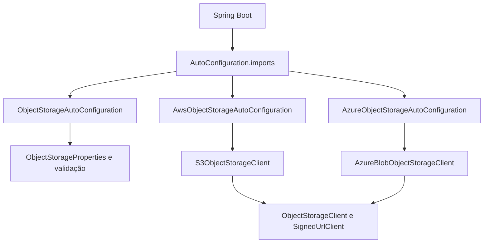
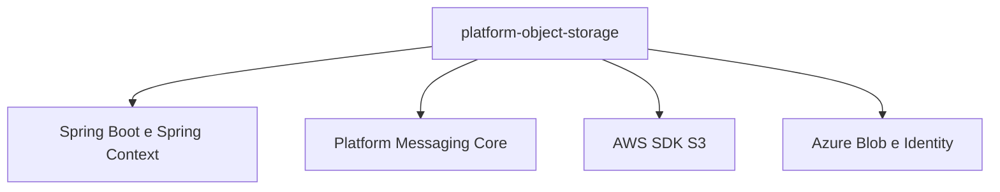
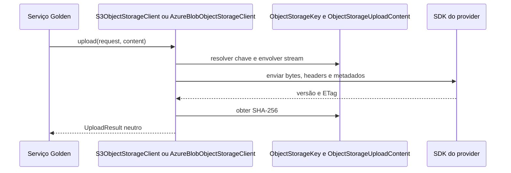

# Platform Object Storage: arquitetura interna

## Para que serve este guia

Este guia acompanha o código de `platform-object-storage`. Ele explica os pontos de entrada, o papel das classes, as dependências e os fluxos AWS S3 e Azure Blob, para que alguém novo no módulo consiga navegar pela implementação e mantê-la.

O [guia da Golden Platform](https://github.com/BrunoBS/golden-platform/blob/main/docs/libraries/modules/platform-object-storage.md) é a referência para configurar e usar a biblioteca como consumidor. Este documento complementa esse guia com detalhes internos.

## Visão da arquitetura

O serviço consumidor depende das interfaces e dos tipos neutros do módulo. O provider é selecionado pela propriedade `platform.object-storage.provider`; as auto configurações condicionais criam o cliente correspondente.

Há dois começos diferentes para acompanhar. Na inicialização do Spring, o registro é `AutoConfiguration.imports`, seguido pelas auto configurações. Na chamada do serviço, os pontos de entrada são as interfaces `ObjectStorageClient` e `SignedUrlClient`.

## Dependências do módulo

| Dependência no POM | Uso no módulo |
|---|---|
| `spring-boot-autoconfigure` | Registra auto configurações, condições e propriedades do Spring Boot. |
| `spring-context` | Fornece contratos usados pela configuração, como `InitializingBean`. |
| `platform-messaging-core` | Reutiliza as exceções e definições de erro padronizadas da Golden Platform. |
| AWS SDK `s3` | Implementa operações S3 e geração de URLs assinadas com `S3Presigner`. |
| `azure-storage-blob` | Implementa operações Blob e geração de SAS. |
| `azure-identity` | Cria a credencial Azure padrão com `DefaultAzureCredentialBuilder`. |
| `spring-boot-configuration-processor` | Opcional; gera metadados para propriedades de configuração. |
| `spring-boot-test-autoconfigure` | Testes de configuração Spring; escopo de teste. |
| `platform-testing-cloud-aws`, `platform-testing-cloud-azure` | Fixtures e emuladores usados pelos testes; escopo de teste. |

As duas SDKs de nuvem estão no mesmo artefato porque esta biblioteca oferece os dois providers sob uma única API. Criar artefatos separados agora adicionaria módulos e configuração de dependências; só valeria reconsiderar com evidência de que o peso transitivo é um problema para os consumidores.

## Inicialização no Spring

1. `META-INF/spring/org.springframework.boot.autoconfigure.AutoConfiguration.imports` lista a configuração comum e as configurações AWS e Azure.
2. `ObjectStorageAutoConfiguration` habilita `ObjectStorageProperties`.
3. `@ConfigurationProperties(prefix = "platform.object-storage")` carrega provider, região ou endpoint e destinos lógicos.
4. `ObjectStorageProperties.afterPropertiesSet()` chama `ObjectStorageConfigurationValidation`, que rejeita configurações incompletas no início da aplicação.
5. `@ConditionalOnProperty` ativa somente a configuração do provider selecionado. `@ConditionalOnMissingBean` permite que a aplicação forneça clientes próprios.
6. O cliente concreto implementa as duas interfaces públicas; não é necessário criar um bean de fachada para cada interface.

| Anotação | Papel neste módulo |
|---|---|
| `@AutoConfiguration` | Marca classes de configuração que o Spring Boot descobre pela lista `AutoConfiguration.imports`. |
| `@EnableConfigurationProperties` | Registra `ObjectStorageProperties` para binding das propriedades. |
| `@ConfigurationProperties` | Liga o prefixo `platform.object-storage` aos campos tipados; `ignoreUnknownFields=false` detecta nomes de configuração inválidos. |
| `@ConditionalOnProperty` | Ativa AWS ou Azure conforme o provider escolhido. |
| `@ConditionalOnMissingBean` | Permite que a aplicação injete seu próprio SDK client ou `ObjectStorageClient`. |
| `@Bean` | Registra clientes SDK e adapter como beans do contexto. Os beans AWS usam `destroyMethod="close"` para fechar os clientes no encerramento. |

## Mapa das classes

### Configuração e inicialização

| Classe | Responsabilidade e motivo |
|---|---|
| `ObjectStorageAutoConfiguration` | Habilita as propriedades comuns do módulo no Spring Boot. É o ponto de configuração independente do provider. |
| `ObjectStorageProperties` | Representa `provider`, `region`, `endpoint` e os destinos lógicos. A classe interna `Destination` guarda o bucket AWS ou container Azure, além de prefixo e sufixo. |
| `ObjectStorageProvider` | Limita o seletor a `AWS` e `AZURE`. |
| `ObjectStorageConfigurationValidation` | Validador package-private que checa provider, destinos e propriedades específicas antes de a aplicação atender chamadas. Mantém os erros de configuração próximos à configuração pública. |

### Contratos públicos

| Classe | Responsabilidade e motivo |
|---|---|
| `ObjectStorageClient` | Contrato de upload, download, consulta de metadados, existência, listagem, histórico de versões e exclusão. O consumidor programa contra essa interface sem usar classes de SDK. |
| `SignedUrlClient` | Contrato separado para criar URL temporária de upload ou download. Mantém explícita essa capacidade sem misturá-la com a assinatura de armazenamento comum. |
| `UploadRequest` | Entrada de upload: destino, chave, tamanho exato, cabeçalhos, metadados e política de escrita. |
| `DownloadUrlRequest` | Entrada de geração de URL temporária de download: referência e validade. |
| `UploadUrlRequest` | Entrada de geração de URL temporária de upload: referência, validade e cabeçalhos que o cliente HTTP terá que enviar. |
| `ObjectReference` | Identifica destino lógico, chave e, opcionalmente, uma versão específica. É usado por operações e respostas. |
| `ObjectHeaders` | Agrupa cabeçalhos HTTP neutros, como `Content-Type` e `Cache-Control`, usados no upload e nas respostas. |
| `WriteMode` | Define `CREATE_ONLY` ou `OVERWRITE`, evitando que a política de sobrescrita fique implícita. |
| `DownloadedObject` | Devolve metadados e o stream aberto. Implementa `AutoCloseable` para deixar clara a responsabilidade do consumidor de fechar o stream. |
| `ObjectMetadata` | Devolve referência real, tamanho, cabeçalhos, ETag, data e metadados do objeto. |
| `ObjectPage` | Representa uma página de listagem comum, com resumos e token opaco para continuar. |
| `ObjectSummary` | Representa os campos leves de um objeto obtidos numa listagem, evitando uma consulta de propriedades por item. |
| `ObjectVersion` | Representa uma versão, incluindo identificador, ETag, tamanho, data, estado atual e marcador de exclusão. |
| `VersionPage` | Representa uma página do histórico de versões e seu token de continuação. |
| `UploadResult` | Devolve referência criada, ETag, tamanho e SHA-256 calculado durante o upload. |
| `SignedUrl` | Devolve URI temporária, expiração e cabeçalhos necessários para a chamada HTTP direta. |
| `request.ContractValidation` e `response.ContractValidation` | Helpers package-private para produzir a exceção de validação sem expor uma classe utilitária na API pública. |
| `request.SignedUrlValidation` | Aplica a regra comum de validade máxima às solicitações de URL assinada. |

Os pacotes `request`, `response` e `model` tornam a navegação do contrato mais rápida. Os records não são camadas de processamento: cada um representa os dados de entrada ou saída de uma operação e concentra validações locais relevantes.

### Implementação interna comum

| Classe | Responsabilidade e motivo |
|---|---|
| `ObjectStorageKey` | Traduz chaves e prefixos lógicos para chaves físicas com prefixo/sufixo, e converte listagens de volta para chaves lógicas. Rejeita caminhos ambíguos, como segmentos `.` e `..`. |
| `ObjectStorageUploadContent` | Envolve o stream para calcular SHA-256 enquanto o SDK lê os bytes. Protege o stream original contra fechamento pelo SDK, pois a posse continua com o consumidor. |
| `ObjectStorageValidation` | Centraliza validações usadas pelos adapters e devolve a exceção padrão do módulo. |
| `ObjectStorageFailureMapper` | Converte erros de protocolo e exceções de provider em exceções padronizadas da plataforma. Trata conflitos de criação com códigos específicos de AWS e Azure. |
| `ObjectStorageMessageKeys` | Mantém as chaves das mensagens padronizadas de armazenamento. Os textos localizados ficam em `src/main/resources/META-INF/platform-messages/`. |
| `ObjectStorageTechnicalErrors` | Cria a definição técnica usada para erros de configuração do módulo. |

### AWS S3 e Azure Blob

| Classe | Responsabilidade e motivo |
|---|---|
| `AwsObjectStorageAutoConfiguration` | Quando `provider=AWS`, cria `S3Client` e `S3Presigner` se a aplicação não os forneceu, e registra `S3ObjectStorageClient`. |
| `S3ObjectStorageClient` | Implementa os dois contratos com a SDK S3. Traduz destinos para buckets, envia e lê streams, usa o presigner para URLs e trata tokens/códigos específicos do S3. |
| `AzureObjectStorageAutoConfiguration` | Quando `provider=AZURE`, cria `BlobServiceClient` com `DefaultAzureCredentialBuilder` se necessário e registra `AzureBlobObjectStorageClient`. |
| `AzureBlobObjectStorageClient` | Implementa os dois contratos com Blob Storage. Traduz destinos para containers, usa propriedades e versões nativas, e gera SAS com chave de delegação do usuário. |

A separação entre os dois adapters é intencional: as chamadas de SDK, condições de escrita, identificação de versão, paginação e assinatura têm diferenças reais. Uma abstração comum para essas chamadas exigiria ramificações por provider e esconderia o comportamento que a manutenção precisa enxergar.

## Fluxo de upload

A aplicação chama o contrato neutro. O adapter escolhido resolve o destino e a chave, prepara o stream com checksum e traduz a operação para o SDK correspondente.

No download, o adapter seleciona a versão opcional e devolve `DownloadedObject`; quem recebeu o resultado fecha o stream. Na listagem, o adapter aplica o prefixo físico, remove chaves fora do escopo lógico e devolve páginas com token opaco. O mesmo token deve ser reutilizado com o mesmo destino e prefixo ou chave.

## URLs assinadas

`SignedUrlClient` recebe os tipos neutros `UploadUrlRequest` e `DownloadUrlRequest`. AWS usa `S3Presigner`; Azure cria SAS e solicita uma chave de delegação. `SignedUrl.requiredHeaders` informa os cabeçalhos que o consumidor precisa mandar ao armazenar diretamente no provider. Na implementação Azure, a identidade configurada precisa ter permissão para obter a chave de delegação quando a URL é criada.

## Revisão de simplicidade

### Ajustes aplicados nesta revisão

- `ObjectStorageFailureMapper` tinha `fromClientFailure` e `fromProviderFailure` com a mesma classificação de timeout, falha transitória e falha genérica. Os dois foram unificados em `fromFailure`.
- Como `SdkClientException` já é tratado pela regra genérica idêntica de `SdkException`, os `catch` duplicados foram removidos do adapter S3.
- `ObjectStorageKey.validateConfiguredPrefix` e `validateConfiguredSuffix` não tinham chamadas. Foram removidos; a validação inicial continua em `ObjectStorageConfigurationValidation`, e as validações de chave em runtime continuam em `ObjectStorageKey`.

### Estruturas mantidas porque esclarecem o contrato

- Requests, responses e modelos permanecem separados: as classes são pequenas, mas dão nome e validação a dados diferentes das operações.
- Os dois adapters e auto configurações permanecem separados porque cada SDK tem semânticas e tipos próprios.
- `ObjectStorageUploadContent` permanece separado porque o cálculo correto do checksum depende do consumo do stream pelo SDK e da propriedade do stream pelo consumidor.
- A biblioteca permanece em um artefato multi-cloud. Dividi-la em artefatos por provider criaria mais módulos e decisões de dependência sem evidência, neste momento, de benefício suficiente.

### Acompanhar antes de extrair mais abstrações

`requirePageSize` e a comparação de ETag têm pequenas duplicações nos adapters. Mantê-las próximas do uso é mais simples enquanto a regra for curta e igual. Se um terceiro provider for adicionado ou as regras divergirem, reavaliar uma extração comum com os testes dos dois providers.

## Testes e validação

Os testes de contrato e configuração ficam em `src/test/java`. Os testes de integração usam os emuladores AWS/Azure; os testes unitários cobrem tradução de erro e transformação de chaves. Esta revisão não executou a suíte local; a validação automatizada deve ser acompanhada pela pipeline do commit.
