# Mapa visual das APIs de teste da plataforma

O mapa cobre as APIs dos oito artefatos de teste. Use a tabela da [arquitetura](ARCHITECTURE.md) para encontrar o módulo proprietário de cada pacote. Os pacotes `architecture`, `container`, `context`, `fixture` e `lifecycle` pertencem ao Core; `http` a HTTP; `authorization` a Authorization; `redis` a Redis; `kafka` a Kafka; `database` a Database; e `cloud.aws`/`cloud.azure` aos módulos correspondentes. Cada contexto mantém seus próprios erros de configuração, sem adicionar `platform-messaging` ao Core.

Este guia mostra como as peças do módulo se conectam e, em seguida, descreve **todos os tipos de produção de nível superior, pacote por pacote**. Use os diagramas para entender o caminho de execução e as tabelas para consultar o papel e as relações de cada classe.

As setas indicam configuração, criação, chamada ou uso. Quando uma classe fica no microsserviço consumidor, isso está indicado explicitamente. Tipos aninhados, como builders e enums de opções, são descritos junto ao tipo que os declara.

## Visão geral: onde o teste encontra a biblioteca

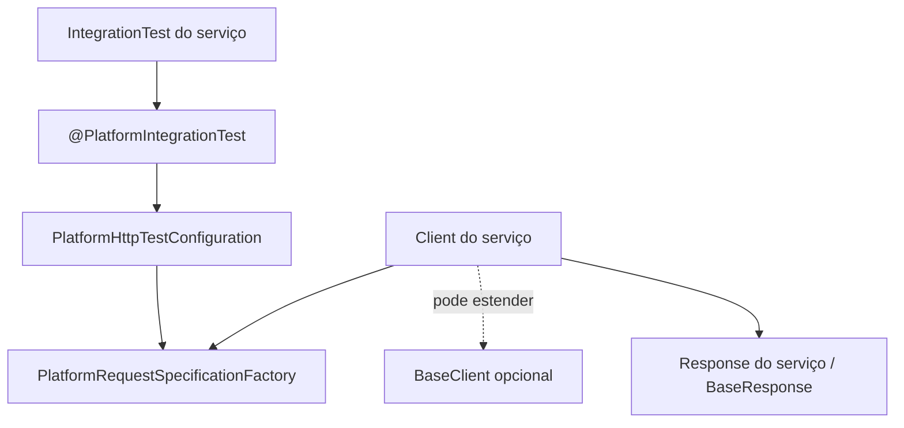

O teste seleciona os recursos de infraestrutura por anotações. A anotação importa a configuração ou o registrar correspondente; esse componente cria somente os containers e clients pedidos.

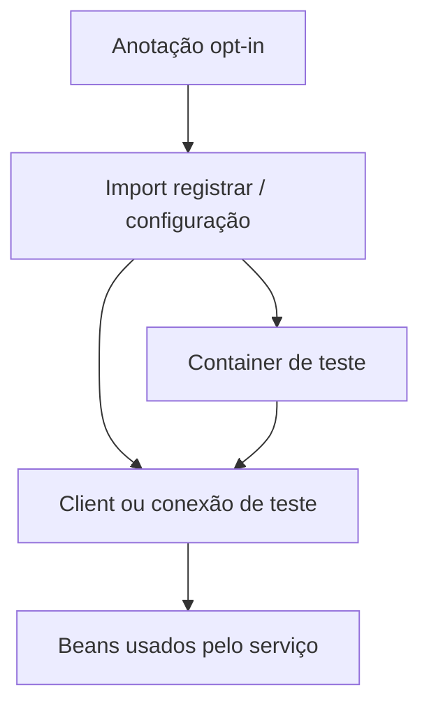

## Builder, factory e scenario

O módulo oferece os contratos e as classes-base. As implementações concretas ficam no contexto do serviço, para montar dados de domínio e preparar pré-condições.

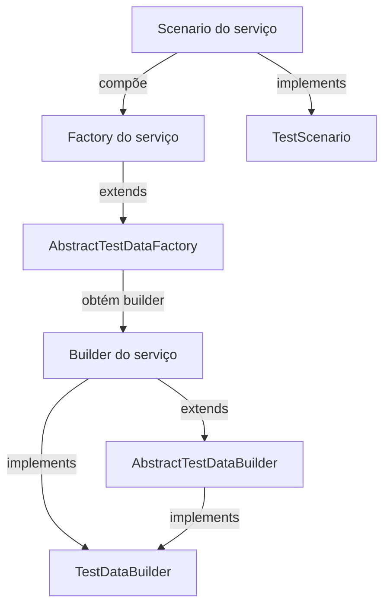

**Como ler:** o builder constrói um objeto; a factory usa o builder para expor variações semânticas; um scenario combina a massa e a preparação de pré-condições. A biblioteca não fornece scenarios de domínio prontos.

## Anotações, extensões e recursos

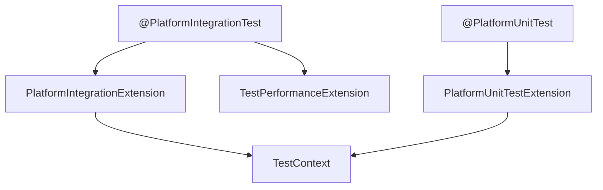

## Autorização simulada

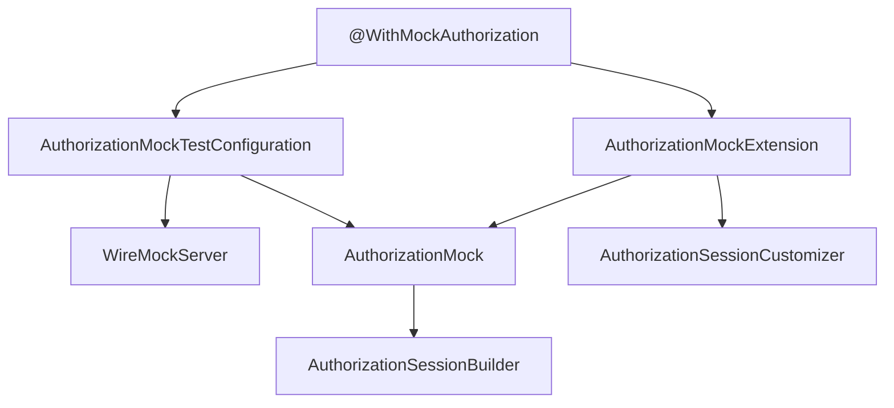

A configuração cria o servidor e direciona as propriedades da aplicação para ele. A extensão limpa os stubs antes de cada teste e registra a resposta padrão. O mock também permite respostas específicas por headers de workspace, aplicação e ambiente.

## Banco MySQL e scripts

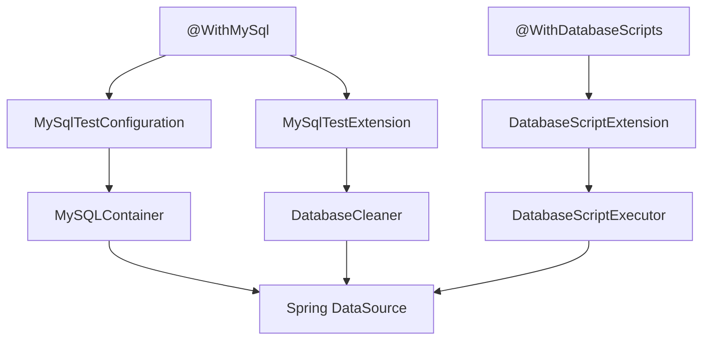

A limpeza do banco e a execução de scripts são mecanismos separados: **MySqlTestExtension** limpa tabelas; **DatabaseScriptExtension** executa setup e cleanup configurados.

## Kafka

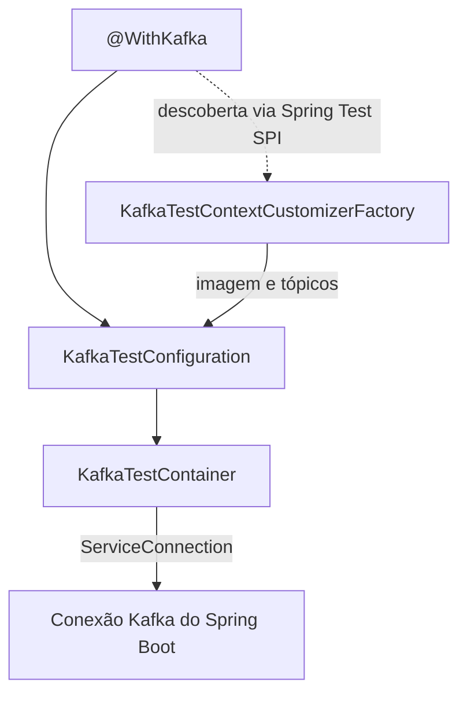

O container cria os tópicos declarados. Serializers, producers e consumers continuam na aplicação; não há limpeza automática dos tópicos entre métodos.

## Redis

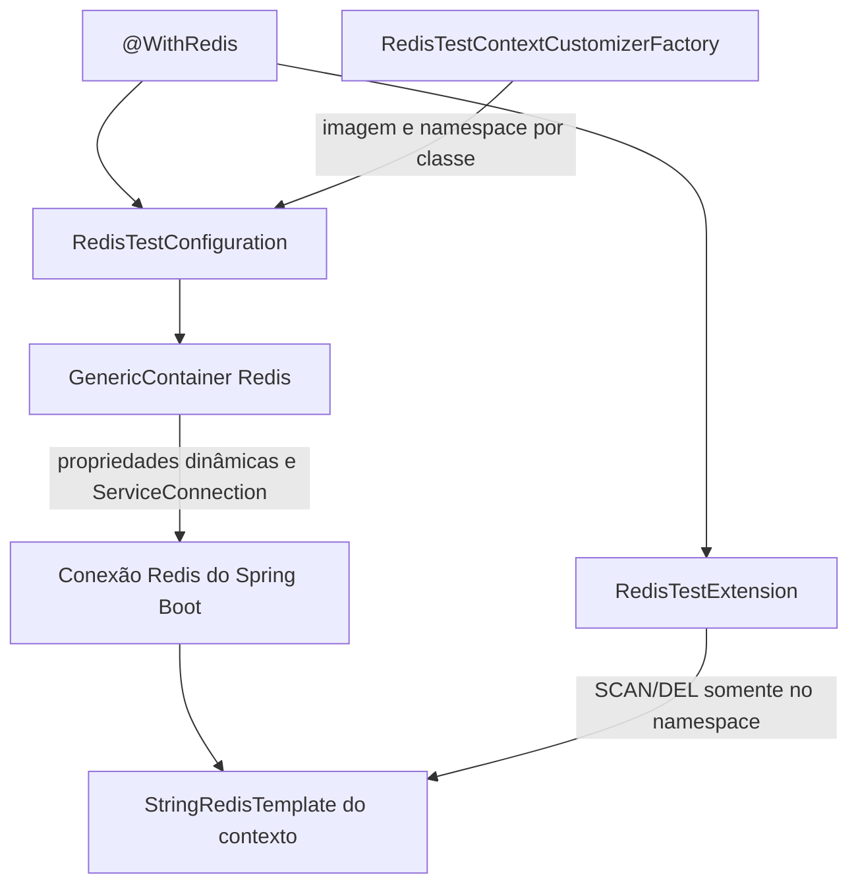

O customizer é descoberto via `spring.factories` e só atua nas classes com `@WithRedis`. A conexão reutiliza o container do contexto. A limpeza ocorre antes de cada método quando habilitada e existe um template resolvido sem ambiguidade; não usa FLUSH global. A fixture não depende da capability `platform-redis`.

## AWS LocalStack

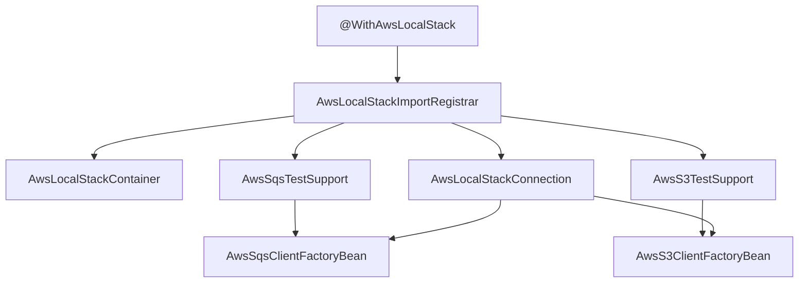

O registrar registra somente os apoios SQS e S3 declarados. Esses apoios criam os factory beans; os factory beans usam a conexão do LocalStack para produzir os clients do AWS SDK.

## Emuladores Azure

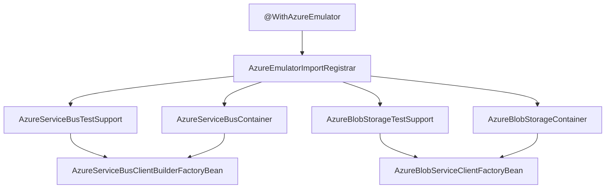

Service Bus coordena o emulador e o SQL Server requerido por ele. Blob Storage usa Azurite e cria os containers especificados na anotação.

## HTTP: criar request, chamar endpoint, validar resposta

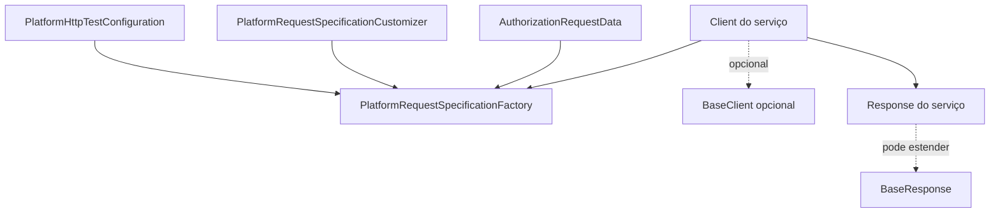

## Inventário por pacote

Os pacotes seguem ordem alfabética. Cada tipo aparece uma única vez, no pacote declarado no código.

### br.com.portalmanager.platform.library.testing.architecture

| Classe | O que faz | Relação com as demais |
|---|---|---|
| **PlatformArchitectureExtension** | Analisa classes concretas do serviço e exige testes para customizações de comportamento herdado da plataforma. | É ativada por **PlatformArchitectureTest**; lê cobertura explícita de **CoversClasses** e também reconhece a convenção de nomes de testes. |

### br.com.portalmanager.platform.library.testing.architecture.annotation

| Classe | O que faz | Relação com as demais |
|---|---|---|
| **CoversClasses** | Declara as classes de produção cobertas por uma classe de teste. | Lida por **PlatformArchitectureExtension** para aceitar cobertura explícita, inclusive quando um teste cobre vários tipos. |
| **PlatformArchitectureTest** | Anotação opt-in que define pacotes do serviço e pacotes base observados. | Ativa **PlatformArchitectureExtension**. |

### br.com.portalmanager.platform.library.testing.authorization

| Classe | O que faz | Relação com as demais |
|---|---|---|
| **AuthorizationMock** | Expõe operações de stubbing e verificação para o endpoint de autorização no WireMock. | Recebe o **WireMockServer** criado por **AuthorizationMockTestConfiguration**; usa **AuthorizationSessionBuilder** e **AuthorizationResourceMatcher** ao montar respostas. |
| **AuthorizationMockExtension** | Limpa o mock e define a resposta padrão antes de cada teste. | É ativada por **WithMockAuthorization**; busca **AuthorizationMock** e os beans **AuthorizationSessionCustomizer** no contexto Spring. |
| **AuthorizationMockResult** | Enum de resultados padrão: permitido, negado, proibido ou erro interno. | O atributo default de **WithMockAuthorization** é lido por **AuthorizationMockExtension**. |
| **AuthorizationMockTestConfiguration** | Cria WireMock, **AuthorizationMock** e propriedades que apontam a aplicação para o servidor local. | É importada por **WithMockAuthorization**; fornece os beans consumidos pela extensão. |
| **AuthorizationResourceMatcher** | Monta condições de headers para um stub específico por workspace, aplicação, ambiente ou header livre. | A função de configuração é passada a **AuthorizationMock.customResource** e **allowResource**. |
| **AuthorizationSessionBuilder** | Produz **UserSession** com valores úteis para testes e customização fluente. | É usado por **AuthorizationMock** e recebe alterações de **AuthorizationSessionCustomizer**. |
| **AuthorizationSessionCustomizer** | Contrato funcional para adicionar atributos a uma sessão de teste. | Implementações do serviço viram beans que **AuthorizationMockExtension** aplica às sessões permitidas. |

### br.com.portalmanager.platform.library.testing.authorization.annotation

| Classe | O que faz | Relação com as demais |
|---|---|---|
| **WithMockAuthorization** | Ativa a simulação de autorização numa classe de teste e escolhe o resultado padrão. | Importa **AuthorizationMockTestConfiguration** e registra **AuthorizationMockExtension**; usa **AuthorizationMockResult**. |

### br.com.portalmanager.platform.library.testing.cloud.aws

| Classe | O que faz | Relação com as demais |
|---|---|---|
| **AwsCloudTestContextCustomizerFactory** | Inclui a declaração WithAwsLocalStack na chave do contexto Spring. | Estende **AnnotationContextCustomizerFactory**; registrada em spring.factories do módulo AWS. |
| **AwsContainerImages** | Define a imagem LocalStack padrão versionada. | Usada pela anotação **WithAwsLocalStack**. |
| **AwsLocalStackConnection** | Fornece endpoint, região e credenciais do container de teste. | Usada pelas factories de clients S3 e SQS. |
| **AwsLocalStackContainer** | Inicia LocalStack e provisiona filas, DLQs, buckets e notificações declaradas. | Recebe a configuração normalizada pelo registrar e fornece AwsLocalStackConnection. |
| **AwsLocalStackImportRegistrar** | Lê a anotação, valida a configuração e registra LocalStack e os recursos selecionados. | Importado por WithAwsLocalStack; delega registro dos clients aos apoios S3/SQS. |
| **AwsService** | Associa os serviços suportados aos nomes reconhecidos pelo LocalStack. | Usado para iniciar somente os serviços solicitados. |
| **AwsTestingTechnicalErrors** | Cria os erros de configuração do módulo AWS. | Usado pelo registrar ao validar as declarações de S3, SQS e notificações. |

### br.com.portalmanager.platform.library.testing.cloud.aws.annotation

| Classe | O que faz | Relação com as demais |
|---|---|---|
| **WithAwsLocalStack** | Ativa LocalStack e compõe as declarações opcionais S3, SQS e notificações. | Importa AwsLocalStackImportRegistrar; reconhecida por AwsCloudTestContextCustomizerFactory. |

### br.com.portalmanager.platform.library.testing.cloud.aws.s3

| Classe | O que faz | Relação com as demais |
|---|---|---|
| **AwsS3ClientFactoryBean** | Cria e encerra o S3Client do AWS SDK apontando para LocalStack. | Registrada por AwsS3TestSupport; usa AwsLocalStackConnection. |
| **AwsS3TestSupport** | Registra a factory do client quando S3 está habilitado. | Chamado pelo registrar quando AwsS3 está presente. |

### br.com.portalmanager.platform.library.testing.cloud.aws.s3.annotation

| Classe | O que faz | Relação com as demais |
|---|---|---|
| **AwsS3** | Declara buckets S3 a provisionar no teste. | Compõe WithAwsLocalStack; interpretada pelo registrar e pelo container. |

### br.com.portalmanager.platform.library.testing.cloud.aws.s3notificationsqs.annotation

| Classe | O que faz | Relação com as demais |
|---|---|---|
| **AwsS3SqsNotification** | Liga um bucket declarado a uma fila SQS padrão declarada. | Compõe WithAwsLocalStack; registrar valida os vínculos e container cria notificação e política. |

### br.com.portalmanager.platform.library.testing.cloud.aws.sqs

| Classe | O que faz | Relação com as demais |
|---|---|---|
| **AwsSqsClientFactoryBean** | Cria e encerra o SqsClient do AWS SDK apontando para LocalStack. | Registrada por AwsSqsTestSupport; usa AwsLocalStackConnection. |
| **AwsSqsTestSupport** | Registra a factory do client quando SQS está habilitado. | Chamado pelo registrar quando AwsSqs está presente. |

### br.com.portalmanager.platform.library.testing.cloud.aws.sqs.annotation

| Classe | O que faz | Relação com as demais |
|---|---|---|
| **AwsSqs** | Declara filas e opções de DLQ; o tipo aninhado Queue descreve cada fila. | Compõe WithAwsLocalStack; suas opções são aplicadas pelo container. |

### br.com.portalmanager.platform.library.testing.cloud.azure

| Classe | O que faz | Relação com as demais |
|---|---|---|
| **AzureCloudTestContextCustomizerFactory** | Inclui a declaração WithAzureEmulator na chave do contexto Spring. | Estende **AnnotationContextCustomizerFactory**; registrada em spring.factories do módulo Azure. |
| **AzureContainerImages** | Define as imagens versionadas de Azurite, Service Bus e SQL Server. | Usada pelas anotações e containers das fixtures Azure. |
| **AzureEmulatorImportRegistrar** | Valida as opções e registra somente os emuladores e clients selecionados. | Importado por WithAzureEmulator; delega aos apoios Blob e Service Bus. |
| **AzureServiceTestSupport** | Contrato de registro de suporte de serviço no contexto Spring. | Implementado por AzureServiceBusTestSupport e usado pelo registrar. |
| **AzureTestingTechnicalErrors** | Cria os erros de configuração do módulo Azure. | Usado pelo registrar e pelo container Service Bus ao validar a configuração. |

### br.com.portalmanager.platform.library.testing.cloud.azure.annotation

| Classe | O que faz | Relação com as demais |
|---|---|---|
| **WithAzureEmulator** | Ativa os emuladores Azure e compõe Blob Storage e Service Bus opcionais. | Importa AzureEmulatorImportRegistrar; reconhecida por AzureCloudTestContextCustomizerFactory. |

### br.com.portalmanager.platform.library.testing.cloud.azure.blob

| Classe | O que faz | Relação com as demais |
|---|---|---|
| **AzureBlobStorageContainer** | Inicia Azurite e cria os containers Blob declarados. | Criado pelo registrar a partir de AzureBlobStorage. |
| **AzureBlobStorageTestSupport** | Registra a factory do BlobServiceClient. | Chamado quando Blob está habilitado; usa AzureBlobServiceClientFactoryBean. |

### br.com.portalmanager.platform.library.testing.cloud.azure.blob.annotation

| Classe | O que faz | Relação com as demais |
|---|---|---|
| **AzureBlobStorage** | Declara os containers Blob a provisionar no Azurite. | Compõe WithAzureEmulator; interpretada pelo registrar. |

### br.com.portalmanager.platform.library.testing.cloud.azure.blobservicebus

| Classe | O que faz | Relação com as demais |
|---|---|---|
| **AzureBlobCreatedEventPolicy** | Converte um upload Blob concluído em evento e o envia ao Service Bus. | Usada no pipeline Blob quando a integração Blob/Service Bus está habilitada. |
| **AzureBlobServiceClientFactoryBean** | Cria o BlobServiceClient e configura a simulação opcional de evento após upload. | Registrada por AzureBlobStorageTestSupport; adiciona AzureBlobCreatedEventPolicy quando aplicável. |

### br.com.portalmanager.platform.library.testing.cloud.azure.servicebus

| Classe | O que faz | Relação com as demais |
|---|---|---|
| **AzureServiceBusClientBuilderFactoryBean** | Cria ServiceBusClientBuilder apontando para o emulador. | Usa AzureServiceBusContainer; registrada por AzureServiceBusTestSupport. |
| **AzureServiceBusContainer** | Coordena a inicialização do emulador Service Bus e do SQL Server requerido. | Criado a partir de AzureServiceBus; fornece os dados de conexão. |
| **AzureServiceBusTestSupport** | Registra o builder do client Service Bus. | Implementa AzureServiceTestSupport; chamado quando Service Bus está habilitado. |

### br.com.portalmanager.platform.library.testing.cloud.azure.servicebus.annotation

| Classe | O que faz | Relação com as demais |
|---|---|---|
| **AzureServiceBus** | Declara filas, sessões e opções de entrega; o tipo aninhado Queue descreve cada fila. | Compõe WithAzureEmulator; configura AzureServiceBusContainer. |

### br.com.portalmanager.platform.library.testing.container

| Classe | O que faz | Relação com as demais |
|---|---|---|
| **PinnedDockerImage** | Valida nomes de imagem com tag explícita ou digest e rejeita tags flutuantes. | Usado pelas fixtures de Database, Redis, Kafka, AWS e Azure antes de criar `DockerImageName`. Os valores padrão ficam em classes do módulo proprietário. |

### br.com.portalmanager.platform.library.testing.context

| Classe | O que faz | Relação com as demais |
|---|---|---|
| **AnnotationContextCustomizerFactory** | Inclui os atributos de uma anotação na chave do cache de contexto Spring. | Classe-base do Core estendida por **AwsCloudTestContextCustomizerFactory** e **AzureCloudTestContextCustomizerFactory**, registradas via spring.factories. |
| **TestContext** | Mantém um correlation ID por thread e cria um ID quando ainda não existe. | A factory HTTP lê o ID; as extensões de ciclo de vida limpam o contexto ao redor de cada teste. |

### br.com.portalmanager.platform.library.testing.database

| Classe | O que faz | Relação com as demais |
|---|---|---|
| **CleanupMode** | Escolhe limpeza antes de cada teste, depois de cada teste ou nenhuma limpeza. | Configura **MySqlTestExtension** via **WithMySql**. |
| **DatabaseCleaner** | Descobre e trunca tabelas MySQL não excluídas; mantém cache da descoberta por banco. | Chamado por **MySqlTestExtension**; os scripts podem invalidar seu cache quando alteram o schema. |
| **DatabaseCleanupPhase** | Define execução do cleanup SQL depois de cada teste ou depois da classe. | Usado pelo atributo homônimo de **WithDatabaseScripts** e interpretado por **DatabaseScriptExtension**. |
| **DatabaseScriptExecutor** | Resolve, valida e executa os arquivos SQL indicados. | Chamado por **DatabaseScriptExtension** em cada fase configurada. |
| **DatabaseScriptExtension** | Executa setup e cleanup na classe ou no método e em ordem inversa para limpeza. | É ativada por **WithDatabaseScripts** e delega SQL a **DatabaseScriptExecutor**. |
| **DatabaseSetupPhase** | Define execução do setup SQL antes da classe ou antes de cada teste. | Usado por **WithDatabaseScripts** e interpretado por **DatabaseScriptExtension**. |
| **DatabaseTestingTechnicalErrors** | Cria os erros de configuração do MySQL usados pela fixture. | Usado por **MySqlTestContextCustomizerFactory** ao validar a imagem. |
| **MySqlContainerImages** | Define a imagem MySQL padrão versionada. | Usada por **WithMySql** e **MySqlTestConfiguration**. |
| **MySqlTestConfiguration** | Declara um MySQL Testcontainers como service connection do Spring Boot. | Importada por **WithMySql**; fornece o banco que a extensão de limpeza acessa. |
| **MySqlTestContextCustomizerFactory** | Descobre WithMySql, valida a imagem e registra suas propriedades antes do refresh. | Registrada via Spring Test SPI; usa **PinnedDockerImage** e **DatabaseTestingTechnicalErrors** e separa contextos por imagem. |
| **MySqlTestExtension** | Aplica o modo e as exclusões definidos na anotação MySQL. | É ativada por **WithMySql** e delega a limpeza a **DatabaseCleaner**. |

### br.com.portalmanager.platform.library.testing.database.annotation

| Classe | O que faz | Relação com as demais |
|---|---|---|
| **DatabaseScripts** | Contém várias declarações de **WithDatabaseScripts** no mesmo elemento Java. | É gerado pelo mecanismo de anotação repetível e lido pela extensão. |
| **WithDatabaseScripts** | Declara arrays de scripts de setup e cleanup, fases de execução e se erros podem ser ignorados. | Registra **DatabaseScriptExtension**; agrupe arquivos na mesma anotação quando compartilham configuração e repita-a só para grupos com opções diferentes; **DatabaseScripts** é o container Java da repetibilidade. |
| **WithMySql** | Opt-in do MySQL e da limpeza automática de tabelas. | Importa **MySqlTestConfiguration**, registra **MySqlTestExtension** e define **CleanupMode** e tabelas excluídas. |

### br.com.portalmanager.platform.library.testing.fixture

| Classe | O que faz | Relação com as demais |
|---|---|---|
| **TestClock** | Cria relógios fixos por instante, com UTC como fuso padrão. | Usado diretamente por builders, factories ou testes de domínio que precisam de tempo previsível. |
| **TestIds** | Gera UUID determinístico a partir de uma seed. | Usado diretamente por fixtures que precisam de identificadores reproduzíveis. |

### br.com.portalmanager.platform.library.testing.fixture.builder

| Classe | O que faz | Relação com as demais |
|---|---|---|
| **AbstractTestDataBuilder** | Classe-base para builders fluentes com tipo concreto preservado por **self**. | Implementa **TestDataBuilder** e simplifica os métodos encadeáveis do builder do serviço. |
| **TestDataBuilder** | Contrato funcional: **build** produz o objeto ou DTO de teste. | Implementado por builders de domínio; aceito por **AbstractTestDataFactory**. |

### br.com.portalmanager.platform.library.testing.fixture.factory

| Classe | O que faz | Relação com as demais |
|---|---|---|
| **AbstractTestDataFactory** | Cria a massa padrão ou aplica uma customização antes de construir o resultado. | Depende de um **TestDataBuilder** concreto; implementa **TestDataFactory**. |
| **TestDataFactory** | Contrato funcional que expõe a massa válida padrão por **valid**. | Implementado diretamente ou herdado por factories de domínio. |

### br.com.portalmanager.platform.library.testing.fixture.scenario

| Classe | O que faz | Relação com as demais |
|---|---|---|
| **TestScenario** | Contrato funcional para **setup** de pré-condições e retorno do resultado preparado. | Implementado no serviço consumidor; pode compor factories e clients, mas não depende de HTTP na biblioteca. |

### br.com.portalmanager.platform.library.testing.http

| Classe | O que faz | Relação com as demais |
|---|---|---|
| **AuthorizationRequestData** | Agrupa token, conta, ambiente e aplicação dos headers autorizados. | Criado pelo builder aninhado ou pelos valores padrão e consumido por **PlatformRequestSpecificationFactory**. |
| **BaseClient** | Helper de herança para criar requests, adaptar respostas e serializar corpos com o **JsonMapper** injetado. | Usa **PlatformRequestSpecificationFactory** e pode produzir classes de resposta que estendem **BaseResponse**; é opcional ao client do serviço. |
| **PlatformHttpTestConfiguration** | Registra a factory HTTP e coleta os customizadores ordenados do contexto. | Importada por **PlatformIntegrationTest**; fornece **PlatformRequestSpecificationFactory**. |
| **PlatformRequestSpecificationCustomizer** | Contrato para alterar um **RequestSpecBuilder** antes de cada request. | Implementado por configurações do serviço; instâncias são fornecidas à factory pela configuração HTTP. |
| **PlatformRequestSpecificationFactory** | Cria requests RestAssured novos com porta local, JSON, correlation ID e customizações; tem variantes autorizadas. | Usa **TestContext** e **AuthorizationRequestData**; é fornecida pela configuração HTTP e consumida pelos clients. |

### br.com.portalmanager.platform.library.testing.http.response

| Classe | O que faz | Relação com as demais |
|---|---|---|
| **BaseResponse** | Oferece assertions fluentes de status e corpo JSON, extração tipada e acesso à resposta HTTP. | Estendida por responses de domínio; clients concretos encapsulam o **ValidatableResponse** nela. |

### br.com.portalmanager.platform.library.testing.kafka

| Classe | O que faz | Relação com as demais |
|---|---|---|
| **KafkaContainerImages** | Define a imagem Kafka padrão versionada. | Usada como default de **WithKafka**. |
| **KafkaTestConfiguration** | Cria o container Kafka como service connection do Spring Boot. | Lê as opções fornecidas por **KafkaTestContextCustomizerFactory** e fornece **KafkaTestContainer**. |
| **KafkaTestContainer** | Inicia Kafka e cria os tópicos opcionais declarados na anotação. | Estende o container Confluent e provisiona tópicos com AdminClient; serializers e producers continuam no serviço consumidor. |
| **KafkaTestContextCustomizerFactory** | Lê e valida imagem/tópicos da anotação e os encaminha ao contexto Spring. | É carregado via Spring Test SPI; seu customizer participa da chave do cache e separa contextos com imagem ou tópicos diferentes. |
| **KafkaTestingTechnicalErrors** | Cria os erros de configuração do Kafka usados pela fixture. | Usado por **KafkaTestContextCustomizerFactory** ao validar imagem e tópicos. |

### br.com.portalmanager.platform.library.testing.kafka.annotation

| Classe | O que faz | Relação com as demais |
|---|---|---|
| **WithKafka** | Habilita Kafka, permite escolher imagem e declara tópicos opcionais. | Importa **KafkaTestConfiguration** e é reconhecida por **KafkaTestContextCustomizerFactory**; o container só inicia quando a anotação é usada. |

### br.com.portalmanager.platform.library.testing.lifecycle

| Classe | O que faz | Relação com as demais |
|---|---|---|
| **PlatformIntegrationExtension** | Limpa o correlation ID antes e depois de cada teste de integração. | É registrada por **PlatformIntegrationTest** e opera sobre **TestContext**. |
| **PlatformUnitTestExtension** | Limpa correlation ID e MDC antes e depois de cada teste unitário. | É registrada por **PlatformUnitTest** e opera sobre **TestContext** e MDC. |
| **TestPerformanceExtension** | Mede a duração dos métodos, registra os lentos e resume tempos ao final da classe. | É registrada por **PlatformIntegrationTest** e não interfere no ciclo de negócio do teste. |

### br.com.portalmanager.platform.library.testing.lifecycle.annotation

| Classe | O que faz | Relação com as demais |
|---|---|---|
| **PlatformIntegrationTest** | Anotação composta de Spring Boot para teste HTTP de integração, profile **test** e servidor em porta aleatória. | Importa **PlatformHttpTestConfiguration** e registra **PlatformIntegrationExtension** e **TestPerformanceExtension**. |
| **PlatformUnitTest** | Anotação composta de Mockito e isolamento leve para testes unitários. | Registra **MockitoExtension** e **PlatformUnitTestExtension**; não sobe o contexto da aplicação. |

### br.com.portalmanager.platform.library.testing.redis

| Classe | O que faz | Relação com as demais |
|---|---|---|
| **RedisContainerImages** | Define a imagem Redis padrão fixada por digest. | Usada como default de **WithRedis** e fallback de **RedisTestConfiguration**. |
| **RedisTestConfiguration** | Inicia GenericContainer, registra host/porta/URL dinâmicos antes das conexões e fornece ServiceConnection. | Importada por **WithRedis**; encerra o container ao fechar o contexto; usa **PinnedDockerImage** e **RedisTestingTechnicalErrors**. |
| **RedisTestContextCustomizerFactory** | Descobre a anotação, valida a imagem e configura namespace exclusivo e modo ISOLATED. | Registrada via Spring Test SPI; imagem e classe participam da chave de cache do contexto; fornece opções para **RedisTestConfiguration**. |
| **RedisTestExtension** | Limpa somente o namespace atual antes de cada método, por SCAN/DEL. | Registrada por **WithRedis**; usa StringRedisTemplate resolvido sem ambiguidade no contexto; respeita **cleanupBeforeEach** e não executa FLUSH global. |
| **RedisTestingTechnicalErrors** | Define erros padronizados de configuração/imagem, startup e limpeza. | Usada por configuração, customizer e extensão com PlatformConfigurationException de Messaging. |

### br.com.portalmanager.platform.library.testing.redis.annotation

| Classe | O que faz | Relação com as demais |
|---|---|---|
| **WithRedis** | Ativa Redis real, permite escolher imagem versionada e controlar a limpeza antes de cada método. | Importa **RedisTestConfiguration**, registra **RedisTestExtension** e é reconhecida por **RedisTestContextCustomizerFactory**. |

## Como manter este mapa útil

Ao adicionar, remover ou mover um tipo de produção, atualize a tabela do pacote. Se mudar quem importa, cria, registra ou chama uma classe, atualize também o diagrama do subsistema afetado.
